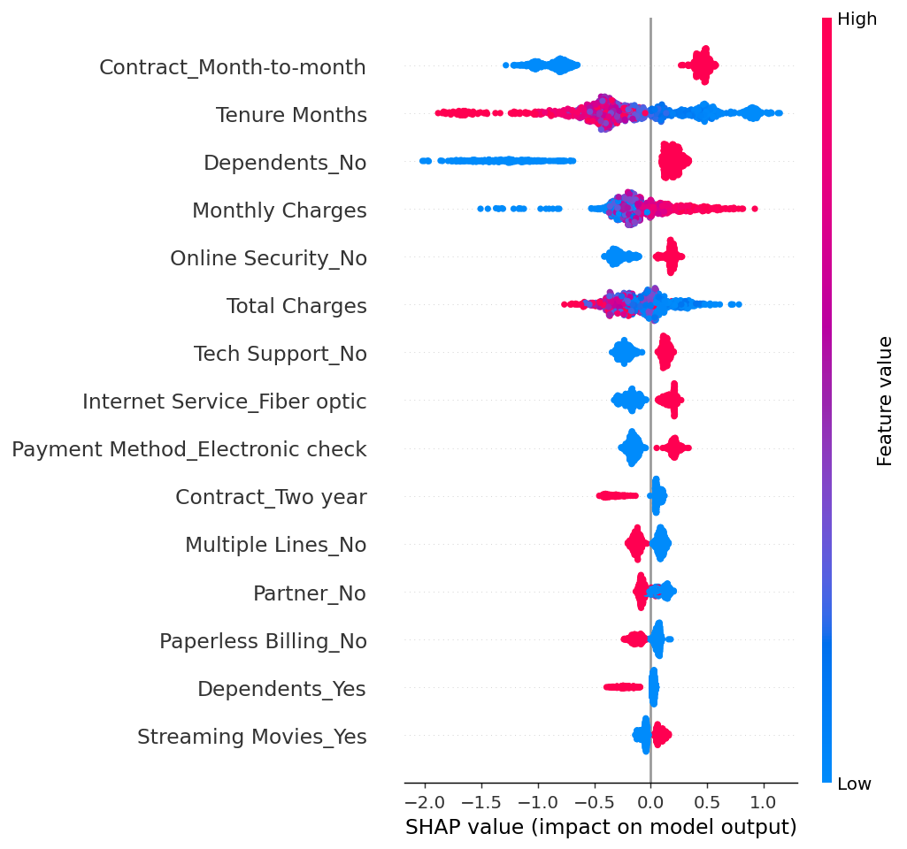
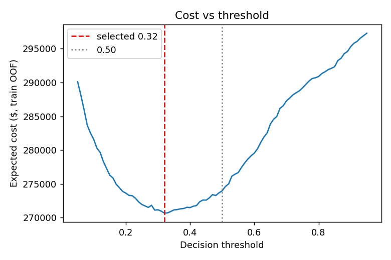

# ChurnGuard: Customer Churn Prediction & Retention

ChurnGuard predicts which telecom customers are likely to leave, explains why, and recommends whether a retention offer is worth making under a configurable cost model. It ships with a Gradio app for single-customer and batch CSV scoring.

## Business problem
Losing a customer costs far more than a targeted retention offer, but contacting everyone wastes money. The goal is to rank customers by churn risk, pick a decision threshold from costs instead of the default 0.50, and show the top drivers behind each prediction.

## Dataset
`Telco_customer_churn.xlsx`, sheet `Telco_Churn`: 7,043 customers, 33 columns, no duplicate rows, 26.5% churn (`Churn Value` = 1). `Total Charges` is stored as text; 11 blank values (all tenure 0) are converted to NaN and median-imputed inside the pipeline. The file is not committed: place it at `data/Telco_customer_churn.xlsx`.

## Preprocessing and leakage prevention
- 19 model inputs: 3 numeric (`Tenure Months`, `Monthly Charges`, `Total Charges`) and 16 categorical.
- Excluded: `CustomerID`, `Churn Label`, `Churn Value`, `Churn Score`, `Churn Reason`, `CLTV`, `Count`, `Country`, `State`, `City`, `Zip Code`, `Lat Long`, `Latitude`, `Longitude`. `CLTV` is excluded because it cannot be shown to be free of outcome information; it is used only in a labelled reporting calculation.
- One `ColumnTransformer` (median impute + scale for numerics; most-frequent impute + one-hot with `handle_unknown="ignore"` for categoricals) lives inside every pipeline, so cross-validation never sees preprocessing fit on validation folds, and unseen categories are handled at inference.

## EDA findings
From `notebooks/churn_analysis.ipynb` (computed on the full dataset):
- Churn by contract: month-to-month 42.7%, one year 11.3%, two year 2.8%.
- Churn by tenure: 0-12 months 47.4%, 13-24 28.7%, 25-48 20.4%, 49-72 9.5%.
- Fiber optic 41.9% vs DSL 19.0%; internet customers without tech support 41.6% vs 15.2% with it.
- Electronic check 45.3% vs 15.2-19.1% for other payment methods.
- Churners have higher median monthly charges ($79.65 vs $64.43) but lower median total charges ($703.55 vs $1,683.60).
These are associations, not proven causes.

## Models and methodology
Stratified 80/20 train/test split (seed 42). All model selection, calibration and threshold tuning use only the training split; the test set is evaluated once at the end. Candidates were compared with 5-fold stratified cross-validation using out-of-fold predictions: Dummy baseline, Logistic Regression (class weights), Logistic Regression + SMOTE, Random Forest (class weights), XGBoost (`scale_pos_weight`), and XGBoost + SMOTE.

**Imbalance handling.** SMOTE runs inside an `imblearn` Pipeline after one-hot encoding, so only the training portion of each fold is oversampled; validation folds and the test set are never resampled. SMOTE is applied to one-hot columns (not SMOTENC), so synthetic rows can have fractional category indicators; this is an approximation, and class weighting performed as well or better.

**Why PR-AUC.** With 26.5% positives, accuracy and ROC-AUC can look good while precision on the churn class is poor. PR-AUC (average precision) measures ranking quality on the minority class, which is what drives who gets an offer. The dummy baseline scores about 0.265 (the churn rate).

## Results (5-fold out-of-fold, training split; precision/recall/F1 at 0.50)
| Model | PR-AUC | ROC-AUC | Precision | Recall | F1 |
|---|---|---|---|---|---|
| XGBoost (scale_pos_weight) | 0.6886 | 0.8636 | 0.5373 | 0.8181 | 0.6486 |
| XGBoost (SMOTE) | 0.6814 | 0.8626 | 0.6080 | 0.6950 | 0.6486 |
| Random Forest (class weights) | 0.6793 | 0.8622 | 0.5584 | 0.7773 | 0.6499 |
| Logistic Regression (class weights) | 0.6760 | 0.8585 | 0.5295 | 0.8094 | 0.6402 |
| Logistic Regression (SMOTE) | 0.6754 | 0.8578 | 0.5410 | 0.7993 | 0.6452 |
| Dummy (prior) | 0.2653 | 0.4999 | 0.0000 | 0.0000 | 0.0000 |

Differences between the top four models are small (under 0.015 PR-AUC), so the choice of XGBoost is a narrow win, not a decisive one. Confusion matrices for each model are in `reports/model_comparison.csv`.

**Held-out test set (1,409 customers), selected model:** PR-AUC 0.6733, ROC-AUC 0.8551. At the selected threshold (0.35): precision 0.562, recall 0.725, F1 0.633, confusion matrix TN 824 / FP 211 / FN 103 / TP 271. At 0.50: precision 0.689, recall 0.545, F1 0.609.

## Calibration
Class-weighted XGBoost scores are not probabilities. Out-of-fold Brier score: 0.1528 uncalibrated, 0.1296 sigmoid, 0.1285 isotonic. Isotonic `CalibratedClassifierCV` (5-fold, fit on the training split only) was selected, so the app's percentages are calibrated probabilities. Plot: `reports/calibration.png`.

## Threshold and cost matrix
Illustrative assumptions (not real company figures; configurable in `src/business.py`): cost of losing a customer $200, offer cost $20, offer success rate 30%.
- Expected net benefit of an offer = churn probability x 0.30 x $200 - $20, which is positive above a break-even probability of 33.3%.
- Expected policy cost = offer costs + (churners x $200, reduced by the 30% success rate when contacted).
- The threshold was chosen on a 0.01 grid by minimising cost on out-of-fold training predictions: **0.35**, then frozen before the test set was scored.

Test-set comparison (estimates under these assumptions):
| Policy | Contacted | Expected cost | Saving vs no offers |
|---|---|---|---|
| Model @ 0.35 | 482 | $68,180 | $6,620 |
| Model @ 0.50 | 296 | $68,480 | $6,320 |
| Contact everyone | 1,409 | $80,540 | -$5,740 |
| No offers | 0 | $74,800 | $0 |

The gain over 0.50 is small (about $300 on this test set), and the whole saving depends on the assumed 30% success rate. A reporting-only CLTV view (mean CLTV of churners x expected retained customers) is printed in `reports/evaluation_summary.md`; it is an estimate, not realised revenue.

## Explainability (SHAP)
`src/explainability.py` uses `shap.TreeExplainer` on the fitted XGBoost model (SHAP values explain the uncalibrated model score; the displayed probability is the calibrated one). One-hot SHAP values are summed back to the original feature so reasons read like "Contract: Month-to-month (raises churn risk)". Global importance (mean |SHAP|, `reports/shap_importance.csv`): Contract, Dependents, Tenure Months, Internet Service, Monthly Charges. Summary plot: `reports/shap_summary.png`.




## Risk categories
High: probability at or above the threshold. Medium: below the threshold but at least 15% (the floor is capped at the threshold so categories stay consistent). Low: below 15%.

## Application
- **Predict one customer:** form with dropdowns and numeric controls; shows probability, risk, recommendation, top three reasons and expected net benefit.
- **Upload a CSV:** validates required columns, ignores target/leakage and extra columns, scores every row through the same pipeline, shows the table and offers a results download plus an example input CSV.
- Loads saved artifacts from `models/`; shows a clear message if they are missing or incompatible.

Application screenshots have not been generated yet; add them to `screenshots/` after running the app locally.

## Run locally
```bash
pip install -r requirements.txt
# place Telco_customer_churn.xlsx in data/
python train.py          # ~1 minute on one CPU; writes models/ and reports/
python app.py            # http://127.0.0.1:7860
pip install jupyter nbconvert && jupyter nbconvert --to notebook --execute --inplace notebooks/churn_analysis.ipynb
```
Artifacts in `models/` total under 400 KB, so the Space needs no retraining or external downloads.

## Deploy to Hugging Face Spaces
```bash
git init && git add . && git commit -m "ChurnGuard"
huggingface-cli login
huggingface-cli repo create ChurnGuard --type space --space_sdk gradio
git remote add space https://huggingface.co/spaces/<your-username>/ChurnGuard
git push space main
```
The metadata block at the top of this README configures the Space. Deployment has not been performed or verified.

## GitHub
```bash
git remote add origin https://github.com/<your-username>/ChurnGuard-Customer-Churn-Prediction.git
git branch -M main && git push -u origin main
```

## Limitations
- Offer success rate, offer cost and loss cost are assumptions; savings are estimates, not proven revenue.
- Single dataset, single snapshot: no time-based validation, so performance on future customers may differ.
- The test set is one split of 1,409 customers; metrics carry sampling uncertainty.
- Churn reasons in SHAP are model associations, not causal effects.
- SMOTE here operates on one-hot features (approximation).

## Demo video checklist
1. Show the project structure and the dataset location.
2. Run `python train.py` (or show `reports/evaluation_summary.md`).
3. Open the app; predict a high-risk and a low-risk customer and read the top reasons.
4. Download the example CSV, upload it, show the table and download results.
5. Show the SHAP summary and the cost-vs-threshold chart, and state the assumptions.

## Technologies
Python, pandas, NumPy, scikit-learn, imbalanced-learn, XGBoost, SHAP, Gradio, Matplotlib, Seaborn, Joblib, Openpyxl, Jupyter.
